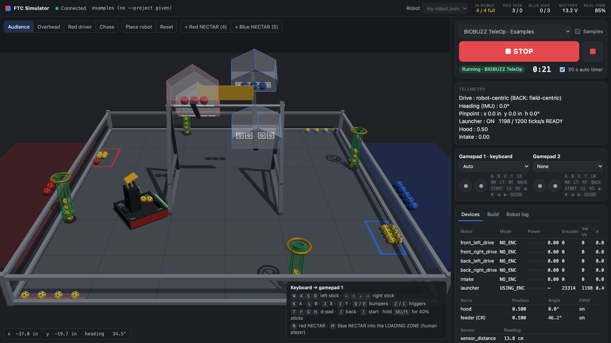

# FTC Simulator

[](https://github.com/Na-Li-CDS/ftc-sim/actions/workflows/windows.yml)
[](https://github.com/Na-Li-CDS/ftc-sim/actions/workflows/ubuntu.yml)
[](https://github.com/Na-Li-CDS/ftc-sim/actions/workflows/macos.yml)

Run your real FTC robot code (the `TeamCode` in your FtcRobotController project) against a
simulated robot on the **BIOBUZZ** (2026–27) field. Drive it from a browser Driver Station with
an Xbox/PlayStation controller or the keyboard. When it works in the simulator, deploy the
same code to the robot as usual. Nothing in TeamCode changes.



## Quick start

1. Install a JDK 17 or newer (Android Studio's bundled JDK works, or [Temurin](https://adoptium.net)).
   `run-sim.bat` also finds a JDK unpacked in `%USERPROFILE%\.jdks`, and `run-sim.sh` one in
   `~/.jdks` (on macOS, including the `Contents/Home` layout, even when macOS's placeholder
   `javac` says "Unable to locate a Java Runtime").
2. Start the simulator with your robot project:

   ```bat
   .\run-sim.bat --project "C:\path\to\FtcRobotController"
   ```

   On macOS and Linux: `sh run-sim.sh --project ~/FtcRobotController`. Without `--project` it
   runs the bundled examples and the official FTC samples.
3. Your browser opens at <http://localhost:8080>. Pick an OpMode, press **INIT**, then **▶ START**.

Defaults live in `sim.properties` (`sim.properties.example` is the template). In this repository it
selects `robots/my-robot.json`; set `project=` there to avoid typing the path every time.

## The edit → simulate → robot loop

- Edit TeamCode in Android Studio or VS Code as you normally do. When you save, the simulator
  recompiles within a second or two and the OpMode list refreshes. If an OpMode is running, the
  rebuild waits until you stop it.
- TeamCode is compiled the way Android Studio compiles it: **Java 8**, against the **FTC SDK 12.0**
  API. An automated test checks the simulator's SDK against the official SDK 12.0 jars, class by
  class and method by method, so code that compiles here also compiles for the robot.
- Files that use something the simulator does not model (for example `VisionPortal`, or
  Android UI classes) are skipped and listed under **Build** with the reason. Everything else still
  runs.
- Never import `ftcsim.*` in TeamCode. Those are simulator internals that don't exist on the robot,
  and the simulator refuses to build a file that uses them.
- Deploy to the robot with your usual tools. The simulator never writes to your project.

## Driving

**Controller.** Plug in or pair an Xbox or PlayStation controller, click the simulator page, and
**press any button**: browsers only expose a controller after a button press. *Gamepad 1 = Auto*
uses the first controller. Rumble (`gamepad1.rumble(...)`, `rumbleBlips(...)`) plays on the
controller in Chrome and Edge (Firefox has no controller rumble), so use Chrome or Edge on any
operating system. The Xbox Guide button may be taken by the Windows Game Bar.

**Keyboard** (used for gamepad 1 when no controller is present, or pick *Keyboard* for either slot):

| Keys | Gamepad |
|---|---|
| W A S D | left stick (W = forward) |
| ← ↑ ↓ → | right stick |
| K · L · J · I | A · B · X · Y |
| Q · E | left / right bumper |
| Z · C | left / right trigger |
| T F G H | d-pad up / left / down / right |
| [ · ] | back · start |
| hold Shift | sticks at 40 % |

With one controller, set **Gamepad 2 → Keyboard** to try two-driver code.

**Human player:** press **N** (red) or **M** (blue), or the *+ Red NECTAR* / *+ Blue NECTAR*
buttons above the 3D view, to put one NECTAR into that alliance's LOADING ZONE (5 per color until
*Reset*).

**The example BIOBUZZ TeleOp** (`examples/teamcode`, default robot):

| Control | Does |
|---|---|
| left stick | drive. Robot-centric: forward = toward the intake, whichever way the robot faces |
| right stick X | turn |
| BACK / View (`[`) | switch to field-centric and back (forward = away from the driver, whichever way the robot faces) |
| A (`K`) | field-centric: make "away from the driver" the way the robot faces now |
| RT / LT (`C` / `Z`) | intake in / out |
| Y (`I`) | launcher on/off; the controller rumbles when it is up to speed |
| RB (`E`) | shoot (only once the launcher is up to speed) |
| d-pad up/down (`T` / `G`) | raise / lower the hood |
| d-pad left/right (`F` / `H`) | launcher speed down / up, 100 ticks/s per press (400 to 2600, starts at 1200) |

**The example BIOBUZZ Parking** autonomous (`examples/teamcode`, `robots/my-robot.json`): starts
with its back against the audience wall, facing into the open end of the red HIVE's audience
CELL, then drives around the A-frame and the red FLOWER and backs into the red LOADING ZONE,
using Pinpoint field coordinates (`pinpoint.setPosition` at START). It takes about 7 seconds and
then preselects BIOBUZZ TeleOp.

## The Driver Station panel

- **OpMode list** with Autonomous and TeleOp groups. Tick *Samples* to show the FTC SDK samples,
  which are `@Disabled` on a real robot.
- **INIT / START / STOP** with the same rules as the real app. The optional **30 s auto timer** stops
  Autonomous OpModes and then preselects the TeleOp named in `preselectTeleOp`.
- **Errors** appear the way the Driver Station shows them, e.g.
  `User code threw an uncaught exception: IllegalArgumentException - Unable to find a hardware device with name "left_drive" and type DcMotor (at MyOpMode.init:42)`.
- **Telemetry**, including `telemetry.log()`, `Func` items, retained items, the 250 ms transmission
  interval and the HTML display format.
- **Devices**: every motor's mode, power, encoder, velocity and current; servo positions; sensor
  readings; hub LED and bulk-caching mode. **Robot log** shows `RobotLog` and `android.util.Log`.
- **3D view**: audience, overhead, red-driver and chase cameras. *Place robot* puts the robot
  anywhere (drag to aim it). *Reset* power-cycles it, which resets encoders and the IMU heading.

## Describing your robot

Robots are JSON files in `robots/`. Choose one with `--robot` or from the top bar.
**Device names must match your robot configuration on the Driver Station**, because your code
looks devices up by those names.

- `robots/mecanum.json`: 18 in mecanum robot (goBILDA 312 RPM, 104 mm wheels) using the SDK 12
  sample names `front_left_drive` …, plus `imu`, `pinpoint`, `sensor_otos`, `sensor_distance`,
  `sensor_color`, `sensor_touch`, `digitalTouch`, and a BIOBUZZ-style `intake`, `launcher`
  (flywheel), `hood` servo and `feeder` CR servo.
- `robots/my-robot.json`: the same mecanum robot, starting with its back against the audience
  wall and facing into the red HIVE's audience CELL (`"start": [-0.3239, -1.5964, 90]`). It is
  the default here through `sim.properties`; the tests keep using `robots/mecanum.json`.
- `robots/tank.json`: six-wheel drop-center tank with `left_drive` / `right_drive`, an arm
  (`left_arm`, also `arm`) and claw servos (`left_hand`, `right_hand`), for the classic samples.

Main fields (meters and degrees; robot frame +x forward, +y left, +z up):

| Section | What it sets |
|---|---|
| `chassis` | size, mass, color |
| `drive` | `type` (`mecanum`, `tank`, `tank4`), wheel diameter, wheelbase, track width, `motor` model, external gear ratio, motor names, grip |
| `imu` | name and how the Control Hub is mounted (`logo`, `usb`, same words as `RevHubOrientationOnRobot`) |
| `devices` | `motor` (with a `load`: `roller`, `flywheel`, `arm` with gravity and hard stops, `slide`), `servo`, `crservo`, `pinpoint` (pod offsets, pod type), `otos`, `distance`, `color`, `touch`, `digital_touch`, `webcam`; each with a mounting position and an optional `role` for the 3D model |
| `io` | simulated bus latency (default 1 ms per hub command, 2.5 ms per I2C read) |
| `start` | starting pose `[x, y, heading]` on the field |

Motor models come from vendor datasheets: goBILDA 5203 (all ratios), REV HD Hex (spur and
UltraPlanetary), REV Core Hex, NeveRest, TETRIX. If you mount a sensor differently from what
your code assumes (for example the IMU orientation or the Pinpoint pod offsets), the readings
are wrong in the same way they would be on the robot.

## What is simulated

- **Physics** uses [ODE4j](https://github.com/tzaeschke/ode4j) at 1 kHz in real time. The robot
  is a chassis plus one body per wheel. Each mecanum wheel grips only along its roller axis, which
  is the standard way Gazebo models mecanum wheels, so strafing, wheel slip and pushing against
  walls behave physically. The robot collides with the walls, the HIVE structure's A-frames and
  the FLOWERS. Balls also hit the A-frame legs, the axle, the sign board and both HIVES' CELLS.
- **Motors** follow their torque-speed curve, sag the battery under load, and BRAKE/FLOAT
  correctly. The **hub firmware** implements `RUN_WITHOUT_ENCODER`, `RUN_USING_ENCODER`
  (velocity PIDF), `RUN_TO_POSITION`, `STOP_AND_RESET_ENCODER`, `setVelocity`, PIDF tuning,
  current and over-current, and **bulk caching** (`OFF` / `AUTO` / `MANUAL`). Encoders don't
  reset between OpModes, just as on a real robot.
- **Sensors**: the Control Hub IMU (`IMU`, yaw/pitch/roll, angular velocity, mounting
  orientation), goBILDA Pinpoint (its own odometry from your offsets, resolution and directions),
  SparkFun OTOS, REV 2m distance (raycast), REV Color Sensor V3 (tape and tiles under it), REV
  touch sensor / digital channel, and battery voltage.
- **Game pieces**: the 40 yellow POLLEN (7.1 cm) and 8 red + 8 blue NECTAR (9.1 cm), staged
  as Competition Manual section 10.3.1 sets them up: 4 POLLEN in each FLOWER, 4 in each GARDEN and
  4 pre-loaded in your robot; the three absent robots' pre-loads sit in the middle of their LOADING
  ZONE against the wall; 3 NECTAR in each upward-facing CELL and 5 in each ALLIANCE AREA. Loose
  balls roll and bounce, slow down with air drag in flight and rolling resistance on the tiles,
  and the robot pushes them. A robot with an `intake` role has a roller across its front, 3 cm in
  radius and 4.5 cm off the tiles, that is solid to balls. The spinning roller picks up a ball that
  touches it (reverse it to spit one out) and holds at most 4 (rule G407; the top bar's
  *In robot* count shows how many it has, and it starts with 4 pre-loaded); a `feeder`
  then sends them into the `launcher`, which throws them at about half the flywheel's surface
  speed, at an angle set by the `hood` servo.
- **HIVES** are solid seesaws. Each CELL has a floor, side walls and a peaked roof, is closed at
  the end next to the pivot and open at the outer end. A ball that goes in through the open end of
  an upward-facing CELL rolls to the back and stays; one that lands on the roof bounces off; one
  in a downward-facing CELL rolls out. Each HIVE turns on its pivot between stops at +-30 degrees
  and is bi-stable like the real one: it holds its position until enough weight lands in the
  upward-facing CELL, then tips (slowed by a damper) and dumps what was in that CELL. It is
  calibrated to the Event Field Setup Guide, section 12.3: a POLLEN tossed onto 3 NECTAR + 1 POLLEN
  or onto 6 POLLEN does not tip it, one tossed onto 3 NECTAR + 2 POLLEN or onto 7 POLLEN does. With
  the 3 starting NECTAR, 2 POLLEN launched by the robot do not tip it and a 3rd does.
  Just over the tipping point it starts slowly: the HIVE can creep for a few seconds before it
  swings over. The
  top bar shows how many balls are in each HIVE's CELLS (audience / rear) and how many times it
  has tipped. That is not a MATCH score. *Reset* also resets the HIVES and the game pieces.
- **FLOWERS** are open tubes built from Competition Manual 9.7: a lower ring on the tiles with a
  7.1 cm hole for the bottom POLLEN, the Retrieval Opening above it (open except for the square
  extrusion on the wall side), a tube as wide as the 10.15 cm top opening up to 54.6 cm, so POLLEN
  stack single file, and the backstop.
  The 4 starting POLLEN are stacked inside. A ball launched or dropped in the top lands on the
  stack. The middle ring lets POLLEN through but not NECTAR: a NECTAR put in the top comes to rest
  on it and stays in the FLOWER, and locks in any POLLEN put in on top of it. Without a NECTAR, a
  POLLEN put into an empty FLOWER falls through and rolls out of the bottom. Drive up to the
  Retrieval Opening and run the intake: the low
  roller reaches in and takes the bottom one, and the rest drop down and are taken one at a time.
  A full robot can bump its roller into the opening instead: a firm bump pushes the bottom POLLEN
  out. Only the weight of the stack holds the bottom one in place, so once it is gone the ones
  above drop through the tall Retrieval Opening and roll out onto the tiles toward the front or
  sides, usually all of them. Real POLLEN are not perfectly round; the simulator gives each one
  that drops out of the middle ring a roll in a random open direction.
  The middle ring has a funnel on top so POLLEN don't catch on its edge. The robot's body stops at
  the FLOWER's frame. On the field four pipes join the upper and middle rings; here the tube is
  closed so balls can't fall out between them.
- **Human player NECTAR**: press **N** (red) or **M** (blue), or the *+ Red NECTAR* / *+ Blue
  NECTAR* buttons, to put one NECTAR from that ALLIANCE AREA into its LOADING ZONE, at rest at
  the first free spot along the alliance wall. Each button shows how many are left (5 per color
  until *Reset*). The robot can intake and launch NECTAR like POLLEN.
- **OpMode lifecycle**: iterative and linear OpModes, `waitForStart`, `opModeInInit`,
  `isStopRequested`, thread interruption on STOP, `requestOpModeStop`, `terminateOpModeNow`,
  `OpMode.blackboard`. When an OpMode ends, motors stop and servos go limp.
- **Loop timing**: hardware calls take about as long as on a real Control Hub, so control-loop
  tuning carries over.

**Not simulated yet**: VisionPortal / AprilTag / color-blob processing, scoring, LEDs and sounds, Limelight, OctoQuad, legacy BNO055 / Modern Robotics sensors.
OpModes that use them are skipped at build time with the reason.

## Checking the simulator itself

```bat
gradlew test
```

The suite includes:

- `ApiConformanceTest`: the simulator's SDK must be a subset of the official FTC SDK 12.0. It
  downloads the official jars from Maven Central.
- `GameElementsTest`: POLLEN and NECTAR counts and staging per section 10.3.1, balls at rest,
  pushing, intake (4-ball limit), launching, and the CELLS: NECTAR stays in the upward-facing
  CELLS, a ball shot into the open end stays, a ball dropped on the roof bounces off, and a ball
  in a downward-facing CELL rolls out; POLLEN stay stacked in the FLOWERS, the intake takes them out
  of the bottom one by one, and a ball dropped in the top lands on the stack.
- `HiveTipTest`: the HIVE calibration table from the Event Field Setup Guide (section 12.3), with
  balls gently placed or tossed in, and a tip dumping the CELL and turning the other CELL up.
- `DrivetrainPhysicsTest`, `RestDriftTest`: speed, strafing, turning, RUN_TO_POSITION, wall
  contact, no drift at rest.
- `SampleOpModesTest`, `ExampleOpModesTest`: the official samples and the examples run end to
  end. For example, `RobotAutoDriveByGyro_Linear` returns to within about 10 cm of its start, the
  Pinpoint auto to within 0.2 in, and the BIOBUZZ TeleOp's shots peak at HIVE CELL height
  (1.4–1.9 m).

On GitHub, these tests run on Windows, Ubuntu and macOS (JDK 21, plus JDK 17 on Ubuntu) for every
push to `main`/`master` and every pull request. Each OS has its own workflow (`windows.yml`,
`ubuntu.yml`, `macos.yml`) and its own badge at the top of this page. All three call the same
steps in [`.github/workflows/test.yml`](.github/workflows/test.yml). On each OS the simulator is
also started with `run-sim.bat` or `run-sim.sh` against a robot project whose path contains
spaces. The run then checks that TeamCode compiles with no files skipped and that the Driver
Station page loads.

## Project layout

| Path | Contents |
|---|---|
| `sdk/` | Desktop stand-in for the FTC SDK 12.0 API (same packages and signatures); simulator internals are in `ftcsim.hal` |
| `engine/` | Physics, robot model, OpMode runner, TeamCode compiler, web server, browser UI (`src/main/resources/web`) |
| `examples/teamcode/` | Example OpModes for the default robot |
| `examples/samples/` | The official FTC sample OpModes that run in the simulator (unmodified) |
| `robots/` | Robot descriptions |

## License

The simulator is released under the [MIT License](LICENSE).

Third-party code in this repository keeps its own license:

| Path | What | License |
|---|---|---|
| `examples/samples/` | FTC SDK sample OpModes, © FIRST | BSD-3-Clause-Clear ([LICENSE-FTC-SDK](examples/samples/LICENSE-FTC-SDK)) |
| `engine/src/main/resources/web/vendor/` | Three.js and OrbitControls, © three.js authors | MIT ([THREE-LICENSE](engine/src/main/resources/web/vendor/THREE-LICENSE)) |

Libraries that Gradle downloads at build time: ODE4j (LGPL-2.1-or-later or BSD-style, at your
choice), Javalin, Gson and Kotlin stdlib (Apache-2.0), Jetty (Apache-2.0 or EPL-2.0), SLF4J (MIT).

The field layout follows the *BIOBUZZ presented by RTX* Competition Manual (FIRST Tech Challenge
2026–27). FIRST®, FIRST® Tech Challenge and BIOBUZZ™ are trademarks of FIRST (For Inspiration and
Recognition of Science and Technology). This project is not affiliated with or endorsed by FIRST.
